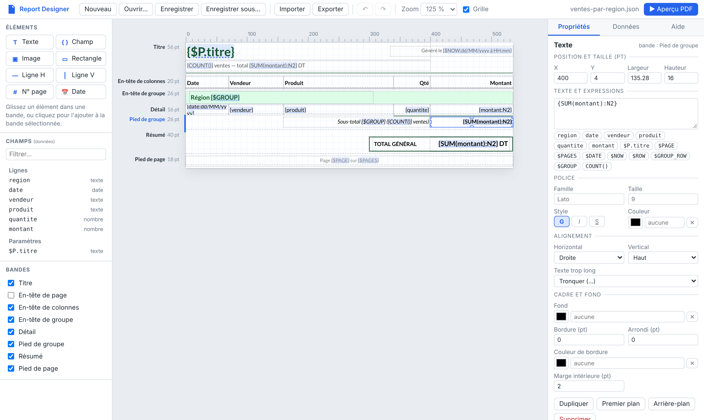

# Report Designer — designer web de rapports PDF avec QuestPDF

Alternative .NET à **JasperReports / iReport** : un designer web par **bandes**, sur le modèle de Jasper,
pour concevoir des modèles de rapport en glisser-déposer, et un moteur qui les génère en PDF avec
[QuestPDF](https://www.questpdf.com/).



## Démarrage

Prérequis : [.NET 10 SDK](https://dotnet.microsoft.com/download).

```bash
dotnet run --project src/ReportDesigner.Web
# puis ouvrir http://localhost:5142
```

Deux modèles d'exemple sont fournis :

- **facture** : facture avec en-tête, lignes, totaux et pied de page ;
- **ventes-par-region** : liste groupée par région, avec sous-totaux et total général.

Cliquez sur **▶ Aperçu PDF** ou appuyez sur <kbd>Ctrl</kbd>+<kbd>Entrée</kbd> pour générer le PDF.

## Structure

| Projet | Rôle |
|---|---|
| `src/ReportDesigner.Core` | Modèle JSON du rapport, moteur d'expressions et rendu QuestPDF. Bibliothèque réutilisable dans vos applications, sans dépendance web. |
| `src/ReportDesigner.Web` | API ASP.NET Core (minimal API) et designer web (HTML/CSS/JS sans framework ni build) dans `wwwroot`. |
| `tests/ReportDesigner.Tests` | Tests xUnit : expressions, rendu PDF et API. |

## Le designer

- **Bandes** comme dans Jasper : Titre, En-tête de page, En-tête de colonnes (répété sur chaque page),
  En-tête de groupe, Détail (une fois par ligne), Pied de groupe, Résumé, Pied de page.
- **Éléments** : texte et expressions, champ, image (PNG/JPEG intégrée au modèle), rectangle,
  lignes horizontale et verticale, numéro de page, date.
- Placement **au point près** : glisser-déposer, redimensionnement par 8 poignées, grille magnétique,
  règle, zoom, sélection multiple (<kbd>Maj</kbd>+clic ou sélection par zone), outils d'alignement.
  Pour déplacer un élément d'une bande à une autre, faites-le glisser vers la bande voulue.
- **Champs** déduits automatiquement des données d'exemple. Faites-les glisser dans une bande :
  - dans l'en-tête de colonnes, un libellé est créé ;
  - dans le résumé ou un pied de groupe, un champ numérique devient `SUM(...)`.
- **Propriétés** : police, taille, gras, italique, souligné, couleurs, alignements, bordures, arrondis,
  marges intérieures, comportement si le texte est trop long (tronquer ou réduire) ; format de page,
  orientation, marges, culture, regroupement.
- **Données d'exemple** (onglet « Données ») enregistrées avec le modèle pour l'aperçu.
- Annuler et rétablir, copier, coller, dupliquer ; enregistrement sur le serveur, import et export JSON.

## Expressions

Tout texte peut contenir des expressions `{expression}` ou `{expression:format}`. Le format est un format
.NET standard, appliqué avec la culture du rapport (par défaut `fr-FR`).

| Expression | Résultat |
|---|---|
| `{nom}`, `{client.adresse.ville}` | champ de la ligne courante (chemin pointé) |
| `{montant:N2}`, `{date:dd/MM/yyyy}` | valeur formatée |
| `{$P.titre}` | paramètre du rapport |
| `{SUM(montant)}`, `AVG`, `MIN`, `MAX`, `{COUNT()}` | agrégats : sur le groupe dans les bandes de groupe, sur tout le rapport ailleurs |
| `{$PAGE}`, `{$PAGES}` | numéro de page et nombre total de pages |
| `{$DATE}`, `{$NOW:HH:mm}` | date et heure de génération |
| `{$ROW}`, `{$GROUP_ROW}`, `{$GROUP}` | numéro de ligne dans le rapport ou le groupe, valeur du groupe |
| `{actif:Oui\|Non}` | libellés d'un booléen |
| `{{` `}}` | accolades littérales |

## Données

Les données sont du JSON, dans l'un de ces formats :

```jsonc
[ { "nom": "Alice", "montant": 12.5 }, ... ]                        // lignes seules
{ "parameters": { "titre": "Ventes" }, "rows": [ { ... }, ... ] }   // paramètres + lignes
```

Pour les groupes, indiquez le champ dans **Regrouper par** (propriétés du rapport). Les groupes suivent
l'ordre de première apparition : les données n'ont pas besoin d'être triées.

## API

| Méthode | URL | Description |
|---|---|---|
| `GET` | `/api/templates` | liste des modèles |
| `GET` / `PUT` / `DELETE` | `/api/templates/{nom}` | lire, enregistrer ou supprimer un modèle |
| `POST` | `/api/render` | `{ "template": {...}, "data": ... }` → PDF (aperçu d'un modèle non enregistré) |
| `POST` | `/api/reports/{nom}` | corps = vos données JSON → PDF du modèle enregistré (`?download` pour un fichier joint) |
| `GET` | `/api/reports/{nom}` | PDF du modèle avec ses données d'exemple |

```bash
curl -X POST http://localhost:5142/api/reports/facture \
     -H "Content-Type: application/json" \
     -d @ma-facture.json -o facture.pdf
```

Les erreurs de modèle (expression inconnue, couleur invalide, bande plus haute qu'une page…) sont
renvoyées en `422` au format *problem details* et affichées dans le designer.

## Utiliser le moteur sans le serveur

Référencez `ReportDesigner.Core`, puis :

```csharp
using ReportDesigner.Core;
using ReportDesigner.Core.Data;
using ReportDesigner.Core.Rendering;

var template = ReportJson.Deserialize(File.ReadAllText("templates/facture.json"));
var data = ReportData.FromJson(json);          // ou new ReportData(rows, parameters)
byte[] pdf = ReportRenderer.RenderPdf(template, data);
```

## Configuration

`appsettings.json` :

```json
"ReportDesigner": { "TemplatesPath": "templates", "FontsPath": "fonts" }
```

- **Modèles** : fichiers JSON dans `TemplatesPath`, faciles à versionner avec Git.
- **Polices** : déposez des fichiers `.ttf` ou `.otf` dans `fonts/`. Ils sont enregistrés au démarrage et
  utilisables par leur nom de famille. Lato, la police par défaut de QuestPDF, est toujours disponible.
  Le designer charge Lato depuis Google Fonts pour que le canevas ressemble au PDF ; hors ligne, il utilise
  une police système, ce qui ne modifie pas le PDF.

## Licence QuestPDF

QuestPDF est gratuit (licence **Community**) pour les organisations dont le chiffre d'affaires annuel brut
est inférieur à 1 M$ USD, ainsi que pour les projets open source et les usages non commerciaux. Au-delà,
une licence Professional ou Enterprise est requise. Le moteur utilise Community par défaut : pour changer
de licence, définissez `QuestPDF.Settings.License` avant le premier rendu.
Voir <https://www.questpdf.com/license/>.

## Limites actuelles

- Les bandes ont une hauteur fixe : un texte plus long que sa zone est tronqué (« … ») ou réduit, mais ne
  fait pas grandir la bande.
- Les expressions ne gèrent pas l'arithmétique (`qte * prix`) : fournissez les valeurs calculées dans
  les données ou les paramètres.
- Un seul niveau de regroupement ; pas de sous-rapports ni de graphiques.
- Les images sont statiques : elles sont intégrées au modèle et ne proviennent pas d'un champ.
- Une seule source de données JSON par rapport : pas de connexion SQL directe.
